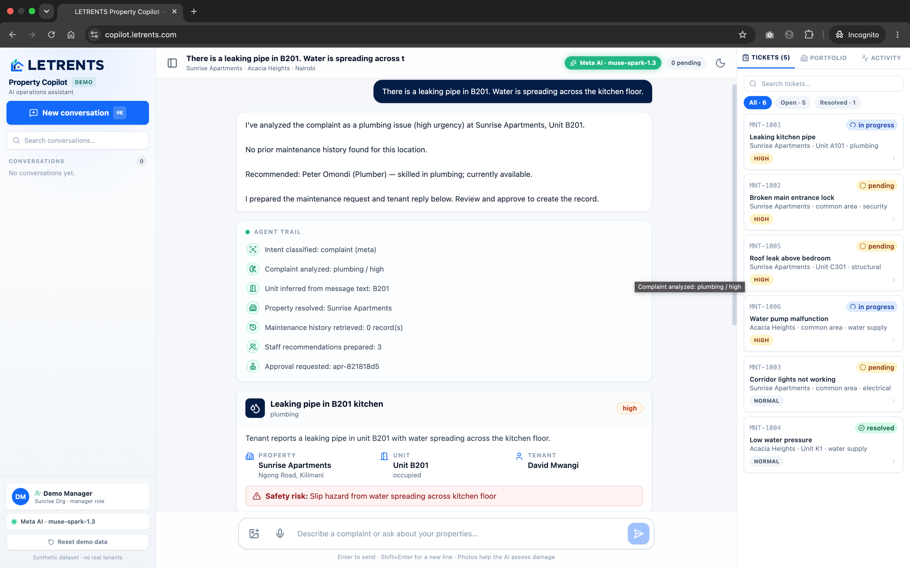
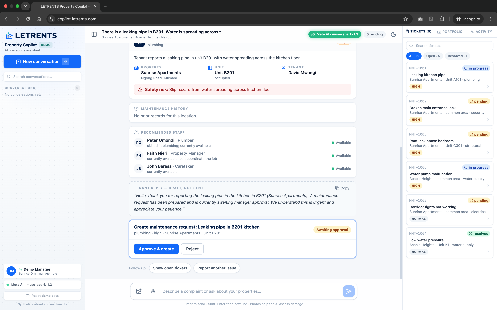
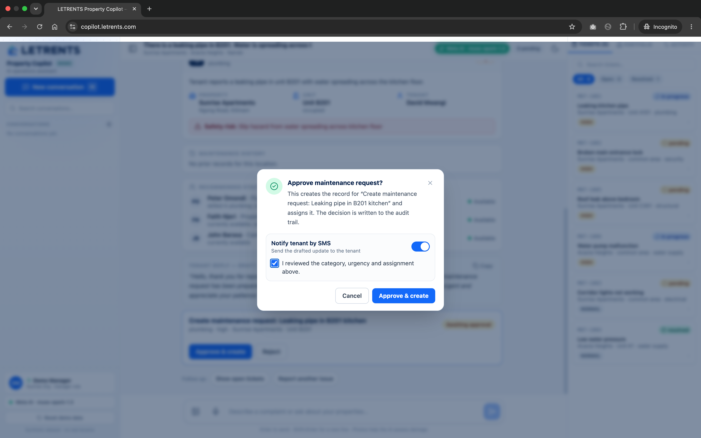
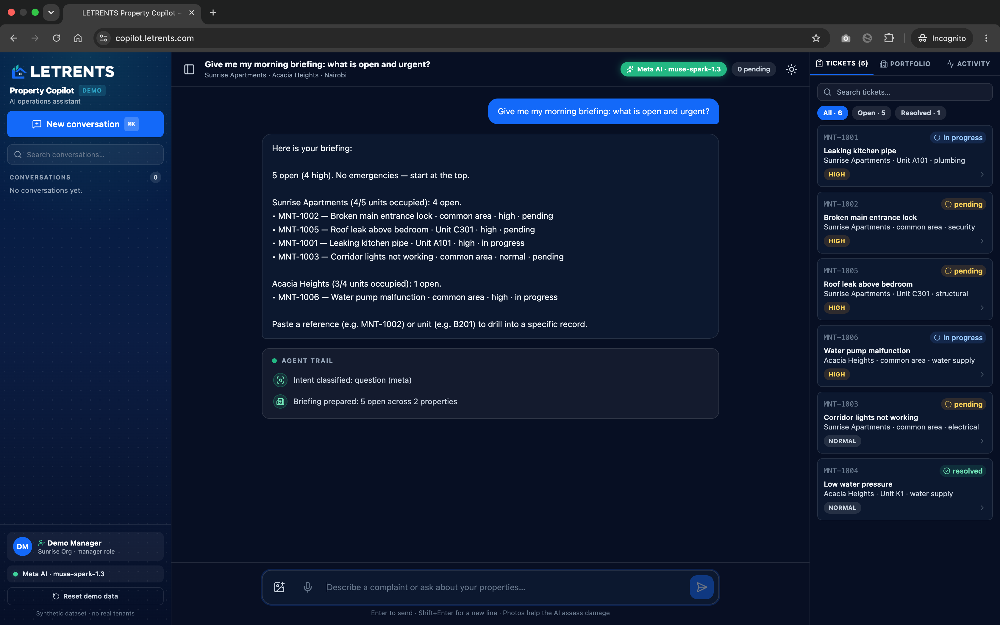
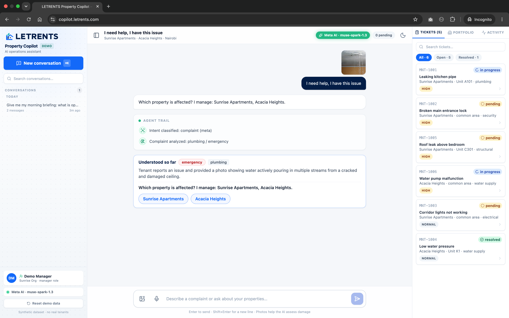
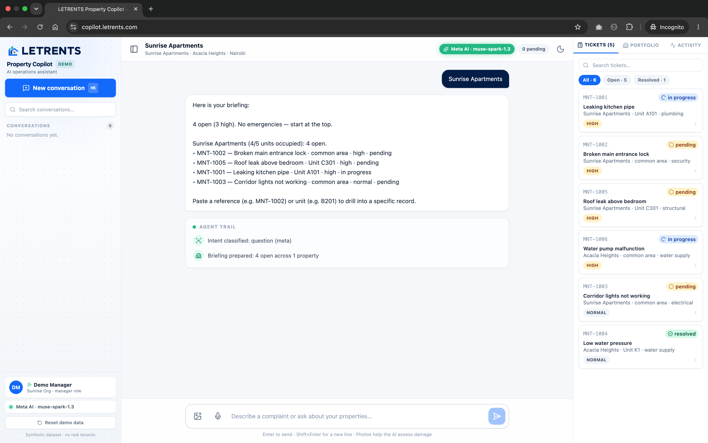

# LETRENTS Property Copilot

**From property complaints to intelligent action.**

An AI property-operations agent for the Meta AI Developer Hackathon. A property
manager describes a maintenance complaint in natural language; the Copilot pulls
real property records, analyzes the issue, checks history, proposes a
maintenance request, recommends staff, drafts a tenant reply — and waits for
human approval before anything consequential happens.

## Problem

Property managers spend hours every day receiving complaints, retrieving
property and tenancy records, categorizing issues, assigning staff, and
communicating with tenants — across calls, chats, and spreadsheets.

## Solution

LETRENTS Property Copilot connects AI reasoning to real property-management
operations through authorized tools:

1. **Understand** — classify the message and extract structured complaint
   details (category, urgency, unit, symptoms) with validated JSON.
2. **Retrieve** — resolve the property/unit, fetch maintenance history, and
   check for duplicates through the adapter (never invents records).
3. **Assess** — apply a deterministic safety layer that overrides the model on
   electrical, fire, flood, gas, structural, or security danger.
4. **Propose** — prepare a maintenance request, staff recommendation, and tenant
   reply as a pending approval.
5. **Approve** — a human reviews and approves/rejects; only then is the record
   persisted and audited.

## Screenshots

Live at [copilot.letrents.com](https://copilot.letrents.com).


*Plumbing complaint analyzed: records resolved, urgency assessed, agent trail visible.*


*Staff recommendations, tenant reply draft, and the approval card awaiting a human decision.*


*Approving opens a confirmation dialog: tenant-notification switch, review checkbox, audit note.*


*Portfolio briefing with triaged tickets and urgency badges, dark theme.*


*A ceiling-leak photo analyzed as a plumbing emergency, with one-tap property options.*


*Briefing scoped to one property, with the triage-ordered ticket panel.*

## Features (implemented)

- Copilot chat workspace with conversation history
- Maintenance complaint understanding (9 categories, 4 urgency levels)
- Property/unit/tenant lookup + maintenance history retrieval
- Duplicate detection (72h window, token-similarity + category match)
- Maintenance request creation through validated, authorized tools
- Staff recommendation ranked by skill match and availability
- Tenant reply drafting (draft only — sending requires approval)
- Human approval workflow (approve/reject with confirmation dialogs, review checklist, and audit notes)
- Property intelligence questions grounded in real records
- Audit/activity history for every action
- Optional maintenance photo upload (sent to Meta vision when configured)
- Synthetic Nairobi demo portfolio (Sunrise Apartments, Acacia Heights)

## Meta AI integration

**Primary provider: Meta Model API** (`https://api.meta.ai/v1`, OpenAI-compatible),
verified live with `muse-spark-1.3`.

| Setting            | Default                                        |
| ------------------ | ---------------------------------------------- |
| `META_API_BASE_URL`| `https://api.meta.ai/v1`                       |
| `META_MODEL`       | `muse-spark-1.3`                               |
| `META_TIMEOUT_MS`  | `30000`                                        |

- The agent uses Meta for intent classification, structured complaint
  extraction, and tenant-reply drafting (`response_format: json_object`,
  temperature 0.2, zod-validated with fence-tolerant JSON parsing).
- All data access runs through server-side tools — the model never touches the
  database and never decides permissions.
- Timeouts, rate limits (429), auth failures, and empty responses are handled
  with user-friendly errors; mid-turn Meta failures fall back to the labeled
  local engine so the demo never crashes.
- **Local fallback:** when `META_API_KEY` is unset or Meta is unreachable, a
  rule-based engine keeps the full workflow runnable. The UI always shows which
  engine answered (green “Meta AI” vs amber “Local fallback” badge).

Verify Meta access (no build needed):

```bash
npm run verify:meta
```

> Live Meta verification status: **verified 2026-11-03** — `npm run verify:meta`
> passes (`muse-spark-1.3`, ~3s), and a full complaint → analysis → approval →
> persisted record cycle was executed against the live API. Note: Muse Spark is
> a reasoning model (~1.5k reasoning tokens per extraction), so agent calls use
> a 4000-token budget. The full workflow is also covered by 28 automated tests
> on the local engine (see Testing).

## Architecture

```
Browser (Next.js App Router, Tailwind)
  │  /api/copilot/*  (thin route handlers, zod input validation)
  ▼
CopilotAgent (sense → plan → act → verify, bounded tool iterations)
  │  structured JSON via AIProvider (Meta primary, local fallback)
  │  deterministic safety overrides
  ▼
Tool registry (13 tools: search_properties, get_unit_details,
  get_maintenance_history, create_maintenance_request, recommend_staff, …)
  │  validated I/O, org isolation, role checks, audit logging
  ▼
PropertyManagementAdapter ──┬── DemoAdapter (public repo, synthetic data)
                            └── ProductionAdapter seam (private LETRENTS services)
```

The public repo ships only the `DemoAdapter` (JSON-file persistence in
`.data/`, seed portfolio in `src/server/demo-data.ts`). The production adapter
implements the same interface against LETRENTS services and stays private.

## Tech stack

- Next.js 15 (App Router) + React 19 + TypeScript (strict)
- Tailwind CSS 3 (LETRENTS palette: navy `#011C47`, blue `#0264FD`, teal `#23A2C7`)
- Zod validation, Vitest tests, JSON-file demo persistence
- Meta Model API (Muse Spark) via `fetch` (no SDK dependency)

## Setup

Requirements: Node.js 20+.

```bash
git clone https://github.com/joseph3559/letrents-property-copilot
cd letrents-property-copilot
npm install
cp .env.example .env
# Optional but recommended: add META_API_KEY to .env
npm run verify:meta   # check Meta access (needs key)
npm run dev           # open http://localhost:3100
```

Other commands:

```bash
npm test        # 27 tests (agent, adapter, safety, schemas)
npm run build   # production build
npm start       # serve production build on :3100
npm run type-check
```

### Environment variables

| Variable              | Required | Purpose                                    |
| --------------------- | -------- | ------------------------------------------ |
| `META_API_KEY`        | Yes*     | Meta Model API key (ai.developer.meta.com) |
| `META_API_BASE_URL`   | No       | Compat endpoint (default api.meta.ai/v1)   |
| `META_MODEL`          | No       | Model id (default muse-spark-1.3)          |
| `META_TIMEOUT_MS`     | No       | Provider timeout (default 30000)           |
| `AGENT_MAX_ITERATIONS`| No       | Tool-call bound per turn (default 8)       |
| `PORT`                | No       | Server port (default 3100)                 |
| `DEMO_DATA_DIR`       | No       | Demo persistence dir (default `.data`)     |
| `DEMO_ORG_ID`         | No       | Demo organization id                       |
| `DEMO_USER_ID`        | No       | Demo manager user id                       |

\* Required for Meta AI inference; without it the app runs on the labeled local fallback engine.

## Demo (3 minutes)

1. **Open** `http://localhost:3100`. Note the engine badge (top right).
2. **Complaint** — click the first demo scenario or type:
   “There is a leaking pipe in B201. Water is spreading across the kitchen floor.”
3. **Analysis** — show the category/urgency card, property + unit + tenant
   resolution, maintenance history, and staff recommendation.
4. **Approval** — review the proposed request + tenant draft, click
   “Approve & create”, confirm.
5. **Result** — the new `MNT-…` record appears in Maintenance; the Activity tab
   shows the audit trail.
6. **Intelligence** — ask “Summarize all unresolved maintenance issues in
   Sunrise Apartments.” and show the grounded answer.
7. **Safety** — try “There are sparks coming from the electrical panel in C301.”
   to show the emergency escalation.

Reset the demo anytime by deleting the `.data/` directory and reloading.

Full scenario checklist (10 scenarios incl. duplicates, rejection, ambiguous
property, unauthorized access, API failure) is covered in `tests/` and
`docs/DEMO.md`.

## Security

- Synthetic demo data only — no real tenants, no production credentials.
- Organization isolation enforced in the adapter on every read/write; foreign
  records return 404 semantics (see `tests/adapter.test.ts`).
- Manager-only mutation role; approval revalidates before executing.
- Secrets server-side only; `.env` gitignored; provider errors sanitized.
- Prompt-injection hardening: model output is schema-validated; approval cannot
  be triggered by model text; safety rules are deterministic code, not prompts.

## LETRENTS integration

The public demo uses `DemoAdapter`. The private LETRENTS platform plugs in a
`ProductionAdapter` implementing `PropertyManagementAdapter` against existing
services (properties, units, maintenance, staff, JWT auth) — the agent,
tools, approval flow, and UI require no changes. No proprietary code or customer
data is included in this repository.

## Project status

P0 complete: Meta provider + fallback, chat, lookup, understanding, history,
creation, approvals, demo data, end-to-end demo, README, tests. Deferred (P2):
SAM 3.1 segmentation, WhatsApp sending (drafts only), advanced analytics.
